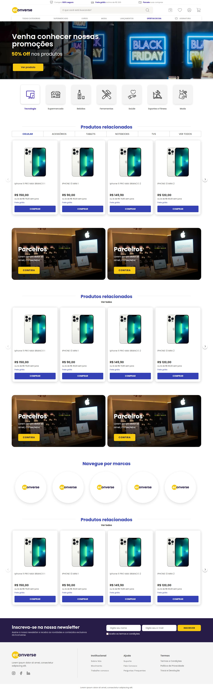
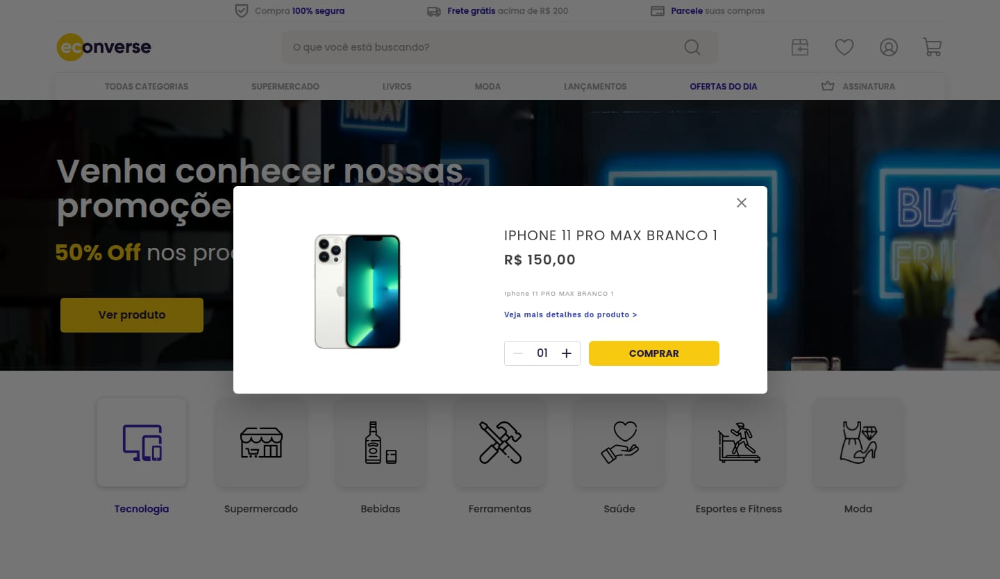

# Teste Econverse — Desenvolvedor Front-End

Home de e-commerce desenvolvida em **React + TypeScript + Sass** a partir do layout
[Teste Front-End Jr](https://www.figma.com/file/rWnzPeoxgynuNPsJjV0VmV/Teste-Front-End-Jr?node-id=0%3A1)
(Figma), com **vitrine de produtos** alimentada pelo
[JSON oficial](https://app.econverse.com.br/teste-front-end/junior/tecnologia/lista-produtos/produtos.json)
e **modal de detalhes** ao clicar em um produto.

| Desktop (1440px) | Modal | Mobile (375px) |
| --- | --- | --- |
|  |  |  |

> Capturas da implementação. As referências exportadas do Figma usadas na comparação visual
> estão em [`specs/001-home-vitrine-produtos/design/`](specs/001-home-vitrine-produtos/design/).

## Requisitos

- Node.js **20 ou superior** (desenvolvido com Node 24)
- npm **10 ou superior**
- Acesso à internet (catálogo de produtos, fotos e Google Fonts)

## Como rodar

```bash
npm install        # instala as dependências
npm run dev        # servidor de desenvolvimento em http://localhost:5173
```

### Build de produção

```bash
npm run build      # checagem de tipos + build otimizado em dist/
npm run preview    # serve o build em http://localhost:4173
```

### Testes e qualidade

```bash
npm test           # testes unitários e de componentes (Vitest + Testing Library)
npm run typecheck  # TypeScript em modo strict
npm run lint       # oxlint (regras de React, TypeScript e acessibilidade jsx-a11y)
npm run format     # Prettier
```

| Script | Descrição |
| --- | --- |
| `dev` | Vite com HMR e proxy do catálogo |
| `build` | `tsc -b` + `vite build` |
| `preview` | Serve `dist/` com o mesmo proxy do catálogo |
| `test` / `test:watch` | Vitest (execução única / modo observação) |
| `typecheck` | Verificação de tipos |
| `lint` | Análise estática |
| `format` / `format:check` | Formatação com Prettier |

## Funcionalidades

- **Página completa conforme o Figma**: barra de benefícios, cabeçalho com busca e ícones,
  menu, banner principal, atalhos de categorias, três vitrines, banners de parceiros,
  marcas, newsletter e rodapé.
- **Vitrine de produtos**: consome o JSON oficial em tempo de execução, exibe foto,
  descrição, preço, parcelamento em 2x sem juros e frete grátis; carrossel próprio com
  setas (4 cards por página no desktop, 3/2/1 em telas menores) e abas de categoria.
- **Modal do produto**: foto, nome, preço, descrição, link de detalhes, seletor de
  quantidade (01–99) e botão COMPRAR; fecha pelo X, pelo clique fora ou pela tecla Esc,
  prende o foco, bloqueia a rolagem da página e devolve o foco ao card de origem.
- **Newsletter** com validação de nome, e-mail e aceite dos termos.
- **Estados de carregamento, erro (com "Tentar novamente") e vazio** na vitrine.
- **Responsivo**: fiel ao layout a 1440px e adaptado até 360px, sem rolagem horizontal.

## Decisões técnicas

| Tema | Decisão |
| --- | --- |
| **CORS do catálogo** | O endpoint do JSON não envia `Access-Control-Allow-Origin`, então o `fetch` direto do navegador é bloqueado. O app consome `/api/produtos`, que o Vite encaminha (proxy) para o endpoint oficial em `dev` e em `preview`. Se a requisição falhar (por exemplo, numa hospedagem estática sem proxy), o serviço usa o snapshot `public/data/produtos.json` e registra um aviso no console. A URL pode ser trocada por `VITE_PRODUCTS_URL`. |
| **Preço** | `price` está em **centavos**: `149990` vira "R$ 1.499,90", exatamente o valor mostrado no modal do layout. A formatação usa `Intl.NumberFormat('pt-BR')`. |
| **Preço "de" riscado** | O JSON não informa preço anterior. O card suporta o campo opcional e, quando ele não existe, reserva o espaço da linha para manter o card com as medidas do layout. |
| **Abas da vitrine** | O JSON não tem categoria e todos os itens são celulares: **CELULAR** e **VER TODOS** listam o catálogo, e as demais abas mostram "Nenhum produto nesta categoria". |
| **Cores** | O Figma (azul `#3442B5`) prevalece sobre a imagem de apoio da vitrine (rosa), por ser o "layout" citado no teste. |
| **Design tokens** | Cores, fontes, tamanhos, sombras e raios foram extraídos da **API do Figma** e centralizados em `src/styles/_tokens.scss`. A posição de cada seção foi medida no navegador e fica a ≤ 1px do Figma a 1440px. |
| **Sem bibliotecas de UI** | Carrossel, modal (`<dialog>` nativo), abas e formulário foram implementados no projeto. As dependências de runtime são apenas `react` e `react-dom`. |
| **Estilos** | SCSS Modules (um por componente) + tokens e mixins compartilhados. |

## SEO e acessibilidade

- HTML semântico: `header`, `nav`, `main`, `section`, `article`, `footer`, `search`, `dialog`.
- Um único `h1` (banner) e `h2` por seção; `lang="pt-BR"`; meta description, Open Graph e
  Twitter Card; `robots.txt`.
- Dados estruturados **JSON-LD** (`ItemList` de `Product`/`Offer`) gerados a partir do catálogo.
- Textos alternativos, `aria-label` nos botões só com ícone, abas no padrão WAI-ARIA
  (navegação por setas, Home e End), live regions para o carrossel e a newsletter, link
  "Pular para o conteúdo", foco visível e respeito a `prefers-reduced-motion`.
- Imagens otimizadas (WebP com `srcset` 1x/2x), `width/height` explícitos e `loading="lazy"`
  abaixo da dobra.

## Estrutura

```text
src/
├── App.tsx                    # composição da Home
├── main.tsx
├── assets/                    # ícones SVG e imagens exportados do Figma
├── components/
│   ├── ui/                    # Button, SectionTitle
│   ├── layout/                # TopBar, Header, MainNav, Footer
│   ├── HeroBanner/
│   ├── CategoryShortcuts/
│   ├── ProductShowcase/       # vitrine: abas, carrossel, JSON-LD
│   ├── ProductCard/
│   ├── ProductModal/          # modal + QuantitySelector
│   ├── PartnersBanners/
│   ├── BrandsSection/
│   └── Newsletter/
├── hooks/                     # useProducts, useCarousel
├── services/                  # productService (fetch + validação + fallback)
├── types/                     # Product, ProductsState
├── utils/                     # formatCurrency, installmentLabel, slugify
└── styles/                    # _tokens.scss, _mixins.scss, global.scss
```

Os testes ficam junto dos módulos que testam (`*.test.ts(x)`).

## Processo: Spec-Driven Development

O projeto foi desenvolvido com o [GitHub Spec Kit](https://github.com/github/spec-kit),
seguindo o fluxo `constitution → specify → clarify → plan → tasks → implement`. Os artefatos
estão versionados:

- [`.specify/memory/constitution.md`](.specify/memory/constitution.md): princípios do projeto
- [`specs/001-home-vitrine-produtos/spec.md`](specs/001-home-vitrine-produtos/spec.md): especificação e clarificações
- [`plan.md`](specs/001-home-vitrine-produtos/plan.md),
  [`research.md`](specs/001-home-vitrine-produtos/research.md) (decisões e design tokens),
  [`data-model.md`](specs/001-home-vitrine-produtos/data-model.md),
  [`contracts/`](specs/001-home-vitrine-produtos/contracts/)
- [`tasks.md`](specs/001-home-vitrine-produtos/tasks.md): tarefas executadas
- [`quickstart.md`](specs/001-home-vitrine-produtos/quickstart.md): roteiro de validação manual

## Instruções originais do teste

As instruções e especificações da Econverse estão no
[repositório original](https://github.com/EconverseAG/teste-front-end).
